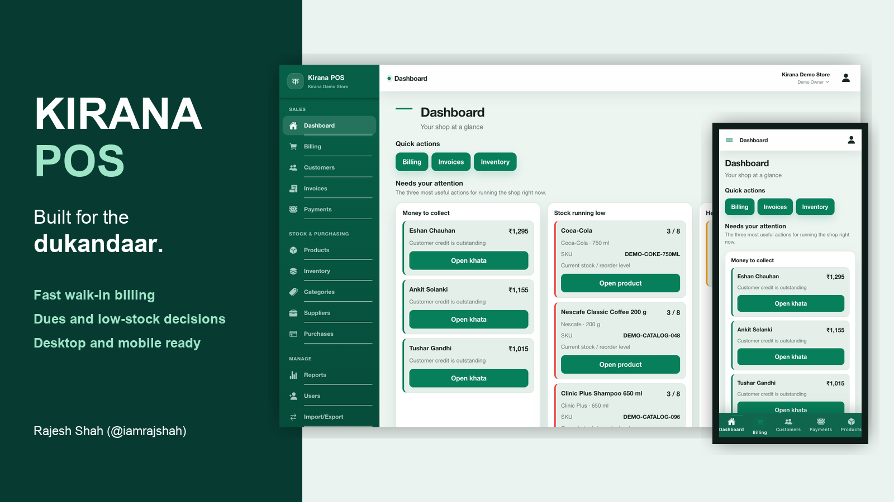
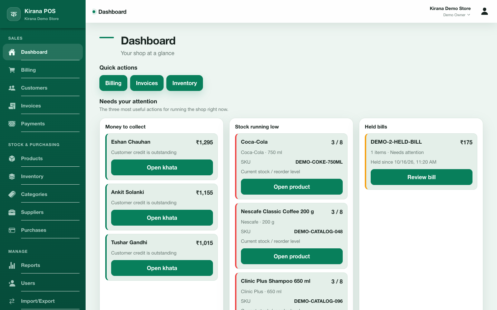
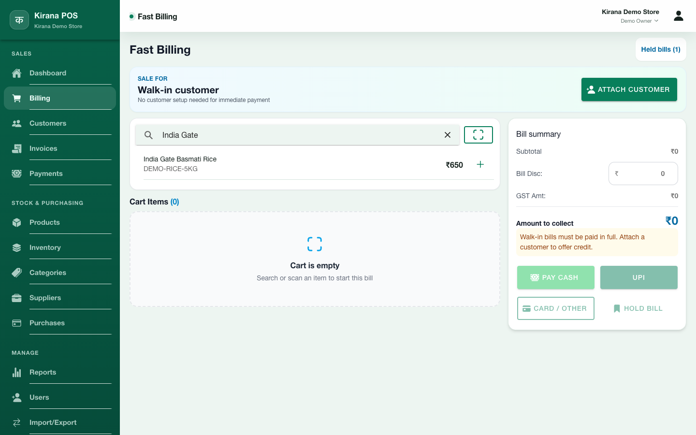
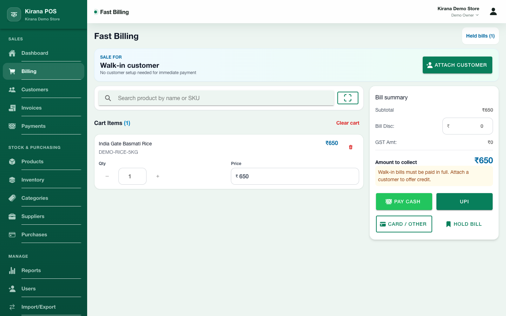
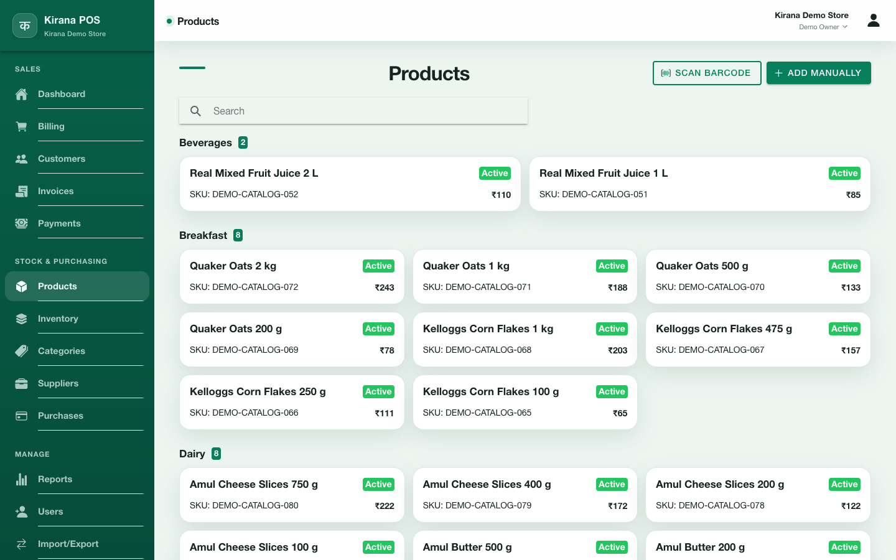
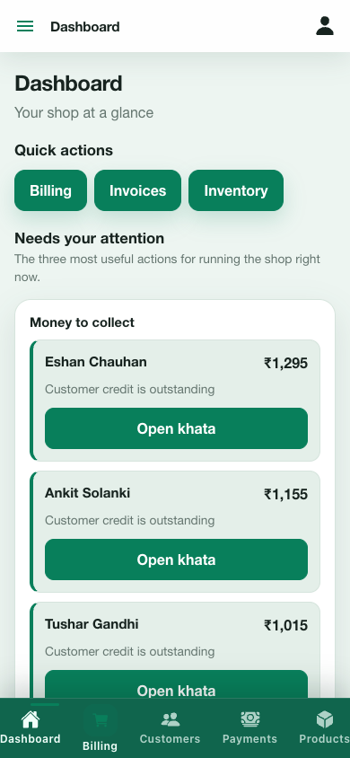
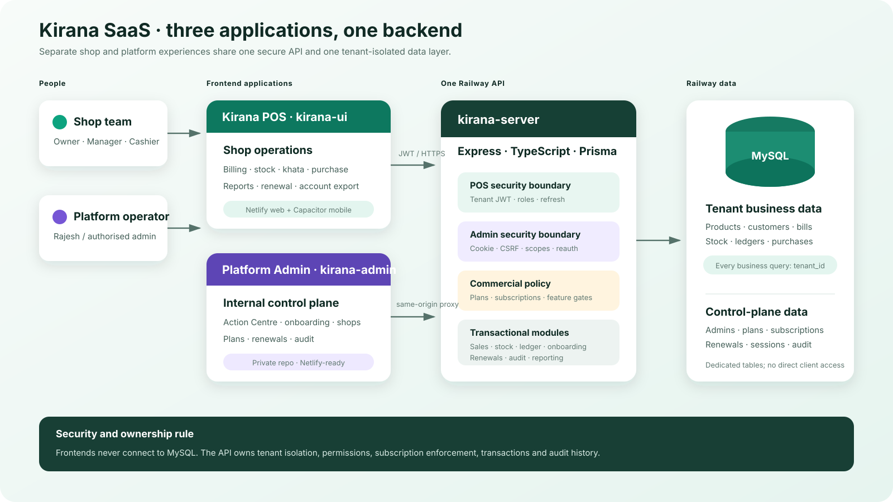

# Kirana POS

> A mobile-first retail operating system that helps neighbourhood stores bill faster and act on dues, low stock, and held transactions without digging through reports.

  

  
  
  
  
  
  

## The product

Kirana POS brings the daily operating work of a small retailer into one responsive product: walk-in billing, barcode-assisted product lookup, stock visibility, customer credit, supplier purchasing, payments, and business reporting.

The experience is designed around the counter rather than around accounting terminology. An owner sees what needs attention, a cashier can create a bill without unnecessary customer setup, and the same workflows adapt from a desktop screen to a phone.

## Watch the product

[Watch the 38-second Kirana POS product tour](demo/kirana-pos-demo.mp4)

The recording uses a deployed demo tenant with synthetic products, customers, balances, and transactions. It contains no real customer data or access credentials.

## Product walkthrough

### Decisions first

The owner dashboard turns operational signals into direct actions: collect an outstanding balance, replenish a low-stock item, or resume a held bill.

  

### Fast walk-in billing

A cashier can search or scan a product, add it to a walk-in bill, adjust quantity or price, and collect through cash, UPI, card, or another payment method. Customer creation is optional for immediate-payment sales.

<table>
  <tr>
    <td width="50%"></td>
    <td width="50%"></td>
  </tr>
  <tr>
    <td align="center"><strong>Search or scan</strong></td>
    <td align="center"><strong>Collect or hold</strong></td>
  </tr>
</table>

### A catalogue built for store operations

Products are grouped for fast discovery and can carry SKUs, prices, active status, stock rules, variants, and reusable barcode labels for store-packed or loose items.

  

### Mobile where it matters

The mobile layout keeps the important actions within reach and preserves the same decision-oriented dashboard instead of reducing the phone experience to a read-only companion.

  

## What I built

- A responsive Ionic React client for owner, manager, and cashier workflows.
- Fast billing with walk-in sales, product search, barcode scanning, held bills, editable quantities and multiple payment modes.
- Inventory, catalogue, customer ledger, supplier, purchase, payment, and reporting workflows.
- Tenant-aware product and operational data boundaries for a shared SaaS platform.
- Redux Toolkit and RTK Query state management with authenticated API access and cache invalidation.
- JWT access and refresh handling, protected routes, role-aware navigation, and idempotency on sensitive billing operations.
- Mobile packaging through Capacitor, with layouts tested from narrow phone widths to desktop screens.
- Automated tests, linting, production builds, and CI/CD-oriented delivery practices.

## Product decisions that mattered

| Challenge | Decision |
| --- | --- |
| Counter speed | Allow immediate walk-in billing without forcing customer creation |
| Owner attention | Put receivables, low stock, and held bills on the landing dashboard with direct actions |
| Mixed catalogue | Support search, scanning, SKUs, categories, pack sizes, and reusable barcode labels |
| Shared SaaS platform | Keep tenant identity and authorization in every protected business operation |
| Duplicate submissions | Use idempotency keys around billing operations that must not be repeated |
| Different devices | Design the same workflow for desktop, tablet, and phone instead of building a separate reduced mobile product |
| Operational safety | Keep the production API, credentials, deployment configuration, and real data outside this public showcase |

## Architecture

  

The product now has three deployable applications: the shop-facing POS, a
private internal Platform Admin, and one modular Express API. Both frontends use
that API; neither accesses MySQL directly. The shared database separates shop
business rows by `tenant_id` and keeps control-plane records in dedicated tables.

[Read the architecture and request flows](docs/architecture.md).

The public diagram shows product boundaries without exposing credentials,
private operational procedures, renewal proofs, or customer information. The
platform is not a collection of artificial microservices.

## AI-assisted engineering

Kirana POS is developed with AI-assisted engineering across product exploration, implementation, test design, review, documentation, and demo preparation. AI accelerates the feedback loop; architecture decisions, security boundaries, verification, and release responsibility remain human-owned.

The practical goal is not to generate the most code. It is to move from an idea to a reviewable, tested product increment with less avoidable rework.

## Public and private boundaries

- The [Kirana POS client repository](https://github.com/iamrajshah/kirana-ui) is available for technical evaluation.
- The production API, infrastructure configuration, deployment controls, and operational data remain private.
- The Platform Admin source repository is private and its deployed application
  requires a scoped server session; it is not part of the public POS bundle.
- The hosted demo uses a seeded tenant. Access may be shared privately with recruiters or collaborators.
- This showcase contains no passwords, reusable tokens, private URLs, or customer data.

## About the builder

Built independently by [Rajesh Shah](https://github.com/iamrajshah), a lead full-stack engineer focused on product-minded architecture, TypeScript platforms, mobile delivery, and AI-assisted engineering.

Connect on [LinkedIn](https://www.linkedin.com/in/iamrajshah/).

---

This repository is a public product showcase. Product assets and source code are not licensed for reuse or redistribution.
