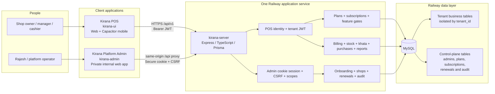

# Kirana SaaS architecture

Kirana has three deployable applications and one shared database. The POS and
Platform Admin are separate frontends; both use the same modular Express API.
There is no direct browser-to-database access and no separate admin or billing
microservice.

## Deployment view

| Application | Current target | Important rule |
| --- | --- | --- |
| `kirana-ui` | Netlify web; Capacitor mobile packages | Calls the API through `/api/v1`; automatic Netlify production builds remain disabled |
| `kirana-admin` | Netlify when credits are available | Private repository; `/api/*` is proxied through the admin origin so the strict session cookie works |
| `kirana-server` | Railway | The only backend; owns authorization, commercial enforcement, transactions and audit |
| MySQL | Railway | Shared schema; tenant business rows carry `tenant_id`, while control-plane records use dedicated tables |

The private admin repository protects source visibility, not the deployed URL.
The application login, scoped server session, CSRF protection and origin allowlist
are the access boundary. Platform Admin can operate SaaS lifecycle metadata but
cannot use its identity to browse a shop's transactional records.

## Typical flows

1. A shop user signs in to the POS. The API resolves identity, tenant,
   subscription and role before returning tenant-scoped data.
2. Billing, khata, purchase and reporting requests stay inside the same API and
   are filtered by `tenant_id` before Prisma reaches MySQL.
3. A platform operator signs in to the standalone admin app. Netlify proxies the
   request to Railway on the same browser origin, preserving the secure cookie.
4. Admin actions pass origin, session, scope and CSRF checks. Sensitive actions
   additionally require fresh password confirmation and an operator reason.
5. Onboarding, plan, subscription and renewal decisions are audit logged. The
   POS sees only the resulting commercial access and shop-facing recovery state.

